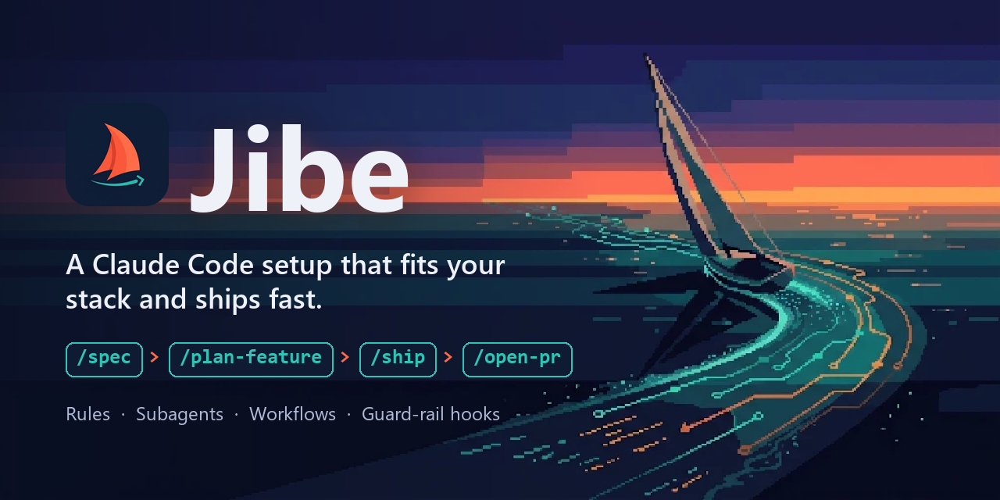
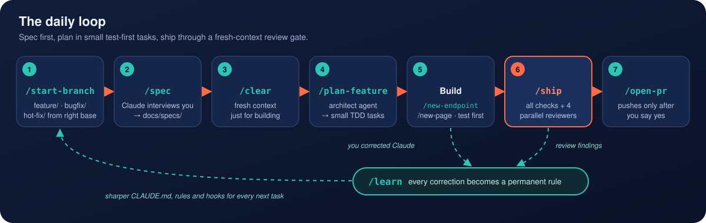
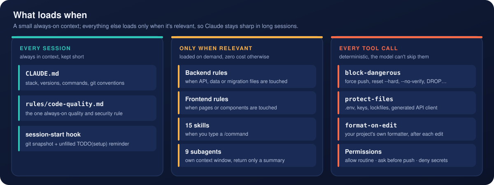
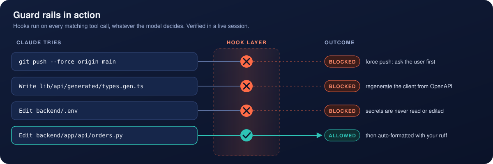
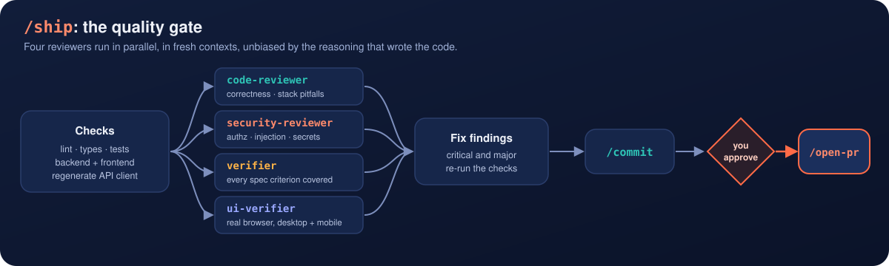
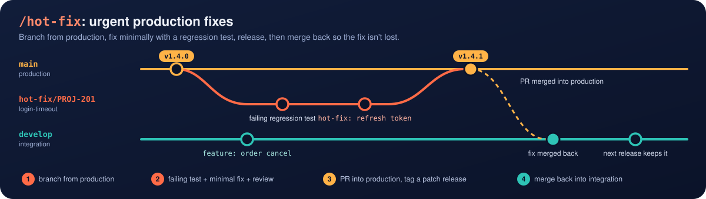

<p align="center">
  
</p>

<p align="center">
  <a href="LICENSE"></a>
  
  
  
</p>

> *jibe* (verb): **1.** to swing a sailing boat decisively onto a new course. **2.** to fit or agree with something ("that jibes with how we work").

Jibe is a drop-in setup for [Claude Code](https://code.claude.com) on full-stack web projects: an API backend with typed schemas and an async ORM, plus a server-rendered component frontend. It includes project memory, path-scoped best-practice rules, specialized subagents, slash-command workflows, and guard-rail hooks. One command installs it, and one slash command tailors it to your repo.

- **Ship faster:** `/spec` -> `/plan-feature` -> `/new-endpoint` / `/new-page` -> `/ship` -> `/open-pr`.
- **Higher quality:** test-first workflows; parallel fresh-context code, security, spec and browser review before every merge.
- **Safe by default:** hooks block force pushes, `reset --hard`, `--no-verify`, destructive SQL, edits to secrets, lockfiles and generated code. Claude asks before pushing or applying migrations.
- **Your git conventions:** `feature/`, `bugfix/`, `hot-fix/`... branches with matching commit prefixes, and no AI attribution in commits or PRs.

## How it works

1. **Install** with `install.sh` / `install.ps1`, which copies `CLAUDE.md` and `.claude/` into your project and never overwrites anything.
2. **Tailor** with `/adapt-setup`, which fills the real commands, versions, branches and rules from your repo.
3. **Work** in the daily loop below.

`/adapt-setup` reads your manifests and CI config, fills every `TODO(setup)` marker, verifies the commands by running them, and removes whatever doesn't apply to your stack.

## Requirements

- [Claude Code](https://code.claude.com)
- git (and the `gh` CLI for PR/issue workflows)
- **Node 20+**: the hooks are small Node scripts, so the same setup works on Windows, macOS and Linux

## Quick start

```bash
git clone https://github.com/sumsam-ali-sac/jibe
cd jibe

# macOS / Linux / Git Bash
bash install.sh /path/to/your-project

# Windows PowerShell
powershell -ExecutionPolicy Bypass -File .\install.ps1 -Target C:\path\to\your-project
```

Then open your project in Claude Code (accept the folder-trust prompt, since pre-approved commands only apply in trusted folders) and run:

```
/adapt-setup
```

Prefer to do it by hand? Follow [guides/SETUP-GUIDE.md](guides/SETUP-GUIDE.md), which has one section per marker. If your project already has a `CLAUDE.md` or `.claude/settings.json`, Jibe's version is saved next to it (`*.starter.*`) and `/adapt-setup` merges it in.

## The daily loop

<p align="center">
  
</p>

```
/start-branch feature PROJ-142 order cancellation
/spec order cancellation                  -> docs/specs/order-cancellation.md
/clear
/plan-feature docs/specs/order-cancellation.md   -> docs/plans/order-cancellation.md
/db-migration ... | /new-endpoint ... | /new-page ... | "execute task N"
/ship docs/plans/order-cancellation.md    -> checks + parallel reviews + commits
/open-pr
/learn <anything you had to correct>
```

A full worked example is in [guides/WORKFLOW-GUIDE.md](guides/WORKFLOW-GUIDE.md).

## What loads when

Claude's context window is its most precious resource, so Jibe loads as little as possible up front and the rest only when it's relevant.

<p align="center">
  
</p>

## Guard rails in action

Hooks are deterministic: they run on every matching tool call, whatever the model decides.

<p align="center">
  
</p>

## The /ship quality gate

<p align="center">
  
</p>

## Git conventions

| Branch | Commit prefix | From -> into |
|---|---|---|
| `feature/PROJ-1-short-desc` | `feature:` | integration -> integration |
| `bugfix/...` | `bugfix:` | integration -> integration |
| `hot-fix/...` | `hot-fix:` | **production -> production**, then merged back |
| `refactor/` `chore/` `docs/` `test/` `release/` | same as prefix | integration -> integration |

The hot-fix flow, which `/hot-fix` runs for you:

<p align="center">
  
</p>

The full rules are in [guides/GIT-WORKFLOW.md](guides/GIT-WORKFLOW.md).

## What's inside

```
template/                        <- copied into your project root
|-- CLAUDE.md                       project memory template with TODO(setup) markers
|-- CLAUDE.local.md.example         personal notes (gitignored)
|-- .mcp.json.example               GitHub, Context7 docs, Playwright, framework devtools
`-- .claude/
    |-- settings.json               permissions (allow/ask/deny), attribution off, hooks
    |-- rules/                      code-quality (always) + backend-api, backend-data, api-contract,
    |                               frontend-app, frontend-components, testing-backend, testing-frontend
    |                               (path-scoped: they load only when matching files are touched)
    |-- agents/                     searcher, architect, debugger, test-writer, code-reviewer,
    |                               security-reviewer, verifier, ui-verifier, docs-writer
    |-- skills/                     /adapt-setup /onboard /start-branch /spec /plan-feature
    |                               /new-endpoint /db-migration /new-page /new-component
    |                               /fix-issue /hot-fix /ship /commit /open-pr /learn
    `-- hooks/                      session-start, block-dangerous, protect-files, format-on-edit
guides/
|-- SETUP-GUIDE.md               install + fill every TODO by hand + verification checklist
|-- WORKFLOW-GUIDE.md            the daily loop, with a full worked example
|-- GIT-WORKFLOW.md              branch types, naming, commits, hot-fix flow, PRs
|-- HOW-PROS-USE-CLAUDE.md       what works and why (with sources)
`-- BUILDING-BLOCKS.md           templates for writing your own agents, skills, rules, hooks
examples/fullstack-app/CLAUDE.md   a fully filled-in CLAUDE.md
install.sh / install.ps1
```

See [template/.claude/README.md](template/.claude/README.md) for a table of every command, agent and hook.

## Personal vs project configuration

| Scope | File | Holds |
|---|---|---|
| All your projects | `~/.claude/CLAUDE.md` | Personal rules (e.g. "never add AI attribution") |
| All your projects | `~/.claude/agents/`, `~/.claude/skills/`, `~/.claude/rules/` | Personal agents, skills and rules everywhere |
| One project, shared | `CLAUDE.md`, `.claude/` | Jibe, tailored and committed |
| One project, just you | `CLAUDE.local.md`, `.claude/settings.local.json` | Local URLs, extra permissions (gitignored) |

## Customizing

Everything is plain Markdown/JSON/JS. Edit it freely. Delete agents and skills you don't use (fewer descriptions means less context per session). When a project teaches you something every project should know, copy it back into `template/`. See [guides/BUILDING-BLOCKS.md](guides/BUILDING-BLOCKS.md).

## License

[MIT](LICENSE)
